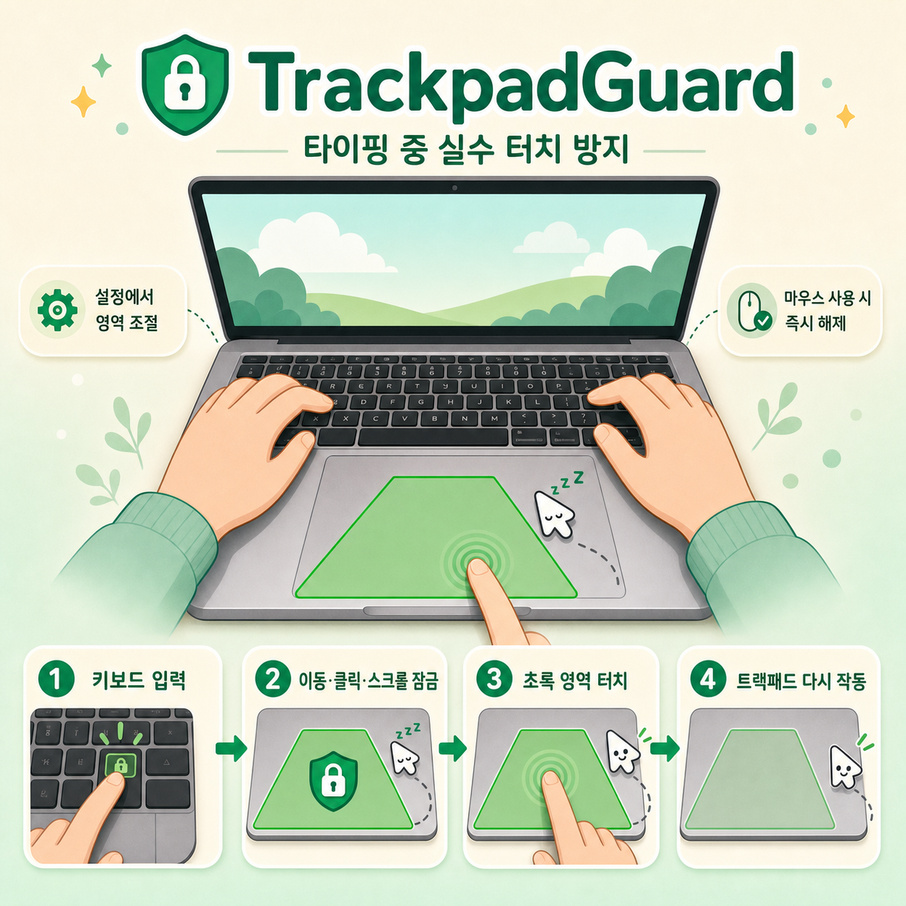

# InputMate (인풋메이트)

> 키보드와 트랙패드를 편하게

앱별 기본 입력 언어 자동 전환, 한글 오타 자동 교정 및 첫 단어 복구, 키보드 입력 중 트랙패드 오작동 방지를 하나로 제공하는 macOS 유틸리티입니다.



*위 이미지는 기존 TrackpadGuard의 트랙패드 보호 기능 안내 이미지이며, InputMate의 새 UI 스크린샷이 아닙니다.*

## 주요 기능

### 1. 앱별 입력 언어 기본값 (App-Entry Language Defaults)
- 터미널(Terminal, iTerm2 등) 진입 시 영어, 대화/문서 앱(카카오톡, ChatGPT 등) 진입 시 한글처럼 앱별 기본 입력 소스를 자동 설정합니다.
- 여러 앱 번들을 한 번에 선택해 공통 입력 소스를 빠르게 일괄 지정하거나 기존 규칙을 개별·일괄 수정할 수 있습니다.
- 앱 내에서 사용자가 수동으로 언어를 변경하면 다른 앱으로 전환하기 전까지 유지되며, 강제로 덮어쓰지 않습니다.

### 2. 한글 자동 교정 및 첫 단어 복구
- 영문 자판으로 잘못 쓴 한글(예: `dkssud` → `안녕`)을 공백이나 문장 부호 입력 시점에 자동으로 교정합니다.
- 영문+한글 혼용 단어(예: `AI로`, `deploy했는데`)를 문맥에 맞게 자연스럽게 보정합니다.
- 지원되는 앱의 빈 입력창에서 첫 단어 입력 시 두벌식 조합 의도를 유지하면서 안전하게 복구합니다.

### 3. 트랙패드 오작동 방지 및 작동 영역
- 키보드 타이핑이 시작되면 트랙패드의 커서 이동, 클릭, 스크롤을 차단합니다.
- 타이핑 후 1초 동안 추가 입력이 없거나, 사용자가 설정한 트랙패드 내 작동 영역을 새로 터치하면 잠금을 즉시 해제합니다.
- 마우스 등 외장 포인터 장치 조작이나 긴급 단축키(`Control-Option-Command-Escape`)로 즉시 해제할 수 있습니다.

## 요구 사항

- macOS 13 (Ventura) 이상
- 트랙패드 보호 기능에만 내장 트랙패드가 필요하며, 키보드 기능(앱별 입력 언어, 한글 교정)은 내장 트랙패드가 없는 Mac에서도 실행할 수 있습니다.
- 시스템 설정의 **개인정보 보호 및 보안 → 손쉬운 사용**에서 InputMate 허용

## 개발 빌드 및 패키징

프로젝트의 SwiftPM 래퍼는 캐시와 모듈 산출물을 모두 프로젝트 안에 둡니다.

```sh
./scripts/swiftpm.sh test
./scripts/package-macos.sh
```

완성된 앱과 로컬 확인용 DMG는 `dist/InputMate.app`, `dist/InputMate-local.dmg`에 생성됩니다. Developer ID 인증서가 설치되어 있으면 자동으로 사용해 기존 앱을 업그레이드할 때 손쉬운 사용 권한 신원을 유지합니다. 인증서를 찾을 수 없으면 기본적으로 빌드가 실패하며, ad-hoc 서명은 `TRACKPADGUARD_ALLOW_ADHOC_SIGNING=1`을 명시했을 때만 사용합니다.

## 직접 배포

Developer ID 인증서로 빌드한 뒤 공증합니다.

```sh
CODESIGN_IDENTITY="Developer ID Application: Your Name (TEAMID)" \
NOTARY_PROFILE="notary-profile" \
./scripts/package-macos.sh --notarize
```

Release 배포는 Sparkle 키와 인증된 GitHub CLI가 준비된 상태에서 `./scripts/publish-release.sh`를 실행합니다.

## 호환성 및 개발자 참고 사항

기존 사용자의 자동 업데이트 연속성과 macOS 시스템 권한 유지를 위해 내부 식별자는 다음과 같이 호환성을 유지합니다:
- **Bundle Identifier**: `com.armsone.TrackpadGuard`
- **실행 파일명**: `TrackpadGuard`
- **GitHub 저장소 / Sparkle 피드**: `armsone/TrackpadGuard` 및 기존 appcast.xml
- 물리적 트랙패드 접촉 좌표를 얻기 위해 시스템의 비공개 `MultitouchSupport` 프레임워크를 런타임에 동적으로 불러오므로 Mac App Store가 아닌 Developer ID 서명 및 Apple 공증 방식으로 직접 배포됩니다.
